# Treasury & Liquidity Reporting Assistant

A training-focused MVP for treasury analysts to assemble end-of-day liquidity reporting using synthetic data sources, deterministic calculations, retrieval-augmented guidance, and a human approval gate.

This project is intentionally educational and not a production banking system.

## Goals

- Retrieve synthetic positions, expected cash flows, and collateral data from three mock sources.
- Compute simplified liquidity metrics deterministically.
- Validate metrics against ground truth and identify anomalies.
- Use ChromaDB and retrieval to ground guidance from treasury policy documents.
- Generate a draft narrative with an LLM, or a deterministic mock fallback.
- Preserve lineage from source record IDs to each metric.
- Require explicit human approval before any report can be released.

## Stack

- Python 3.11
- FastAPI
- Pydantic
- Streamlit
- ChromaDB
- sentence-transformers
- OpenAI-compatible LLM interface
- OpenTelemetry + Jaeger
- Prometheus + Grafana
- Pytest
- Docker Compose

## Local run

This project is validated on Python 3.11.x. Do not use Python 3.14 with the current dependency stack because the transitive `tokenizers`/PyO3 build fails on 3.14.

### 1) Create and activate an environment

```bash
py -3.11 -m venv .venv
.venv\Scripts\activate
python -V
pip install --upgrade pip
pip install -r requirements.txt
```

If you are on macOS/Linux, use:

```bash
python3.11 -m venv .venv
source .venv/bin/activate
pip install -r requirements.txt
```

### 2) Configure environment variables

Create a `.env` file in the project root with your OpenAI configuration. The app uses:

- `OPENAI_API_KEY` for LLM calls
- `OPENAI_MODEL` for chat generation
- `OPENAI_EMBEDDING_MODEL` for Chroma embeddings
- `USE_MOCK_LLM=false` to enable the real OpenAI model path

Example:

```dotenv
OPENAI_API_KEY="<your-api-key>"
OPENAI_MODEL=gpt-4o-mini
OPENAI_EMBEDDING_MODEL=text-embedding-3-small
USE_MOCK_LLM=false
```

Optional settings:

```dotenv
APP_ENV=development
DEBUG=true
HOST=0.0.0.0
PORT=8000
JAEGER_ENDPOINT=http://localhost:4318
PROMETHEUS_PORT=9090
CHROMA_HOST=localhost
CHROMA_PORT=8001
CHROMA_PATH=.chromadb
```

ChromaDB persists its collection in `.chromadb/` by default. The application ingests the local Treasury guidance on startup when the collection is empty; override `CHROMA_PATH` to use another directory.

### 3) Rebuild the vector store with the same embedding model

The Chroma database must be rebuilt if it was previously created with a different embedding model. Run this from the project root:

```powershell
python -m scripts.ingest_knowledge
```

This ensures the same `OPENAI_EMBEDDING_MODEL` is used for all knowledge chunks in ChromaDB.

### 4) Start the API

```powershell
..\treasure\Scripts\Activate.ps1
uvicorn app.main:app --reload --host 0.0.0.0 --port 8000
```

If you are already inside the activated environment, you can just run:

```powershell
uvicorn app.main:app --reload --host 0.0.0.0 --port 8000
```

Check:

- http://localhost:8000/docs
- http://localhost:8000/health
- http://localhost:8000/metrics

### 5) Start the Streamlit dashboard

```powershell
..\treasure\Scripts\Activate.ps1
streamlit run dashboard/streamlit_app.py
```

If already activated:

```powershell
streamlit run dashboard/streamlit_app.py
```

The dashboard allows you to:

- choose a scenario (`healthy`, `stale`, `outlier`)
- enter a run ID
- generate a draft treasury report
- review the returned metrics and narrative

## Docker Compose

This repo also includes the full monitoring stack for the demo:

```bash
docker compose up --build -d
```

Services exposed locally:

- FastAPI app: http://localhost:8000
- Streamlit dashboard: http://localhost:8501
- Jaeger UI: http://localhost:16686
- Prometheus: http://localhost:9090
- Grafana: http://localhost:3000

If you need to stop the stack:

```bash
docker compose down
```

## Monitoring and tracing

### Jaeger

Jaeger is configured to collect OpenTelemetry spans from the FastAPI app.

- URL: http://localhost:16686
- Purpose: inspect request traces and latency

### Prometheus

The app exposes Prometheus metrics at:

```text
http://localhost:8000/metrics
```

Useful metric names include:

```text
treasury_report_requests_total
treasury_last_liquidity_ratio
treasury_last_evaluation_score
treasury_pending_review_reports
treasury_human_reviews_total
```

### Grafana

Grafana is provisioned with a Prometheus datasource and a basic liquidity dashboard.

- URL: http://localhost:3000
- Login: admin / admin

To confirm the Prometheus target is healthy:

- Open http://localhost:9090/targets
- Confirm the `treasury-app` target is `UP`

## Demo flow

1. Ensure the FastAPI app is running.
2. Ensure the Streamlit dashboard is running.
3. In the dashboard, choose a scenario and click `Generate draft report`.
4. The request goes to the FastAPI backend.
5. The backend calculates liquidity metrics, checks freshness, retrieves guidance, and generates a narrative.
6. Prometheus records the metrics.
7. Grafana shows the metrics dashboard.
8. Jaeger shows the trace for the full request.

## Notes

- The application never auto-submits a report.
- All outputs should be reviewed by a human before release.
- This repository intentionally uses synthetic data only.
- The default demo mode is intentionally safe and deterministic; using real OpenAI requires a valid API key and `USE_MOCK_LLM=false`.
- For ChromaDB embedding consistency, always re-index the knowledge after changing `OPENAI_EMBEDDING_MODEL`.

## Architecture

```mermaid
flowchart LR
    classDef analyst fill:#eaf2ff,stroke:#2b5d9f,color:#111,stroke-width:1.5px;
    classDef app fill:#eefaf2,stroke:#2e7d32,color:#111,stroke-width:1.2px;
    classDef data fill:#fff4e5,stroke:#b97700,color:#111,stroke-width:1.2px;
    classDef rag fill:#f3e8ff,stroke:#6a1b9a,color:#111,stroke-width:1.2px;
    classDef obs fill:#fce8f3,stroke:#a21caf,color:#111,stroke-width:1.2px;
    classDef review fill:#fff1f2,stroke:#be123c,color:#111,stroke-width:1.5px;
    classDef state fill:#f3f4f6,stroke:#374151,color:#111,stroke-width:1.2px;

    TA["Treasury Analyst"]:::analyst
    ST["Streamlit\n`dashboard/streamlit_app.py`"]:::app
    API["FastAPI\n`app/main.py`"]:::app
    ORCH["Orchestrator\n`app/agent/orchestrator.py`"]:::app

    subgraph AUTH_PATH["AUTHORITATIVE FINANCIAL PATH"]
        POS_SRC["Positions JSON\nmock source"]:::data
        CF_SRC["Cashflows JSON\nmock source"]:::data
        COL_SRC["Collateral JSON\nmock source"]:::data

        POS_TOOL["PositionsTool\n`app/tools/positions_tool.py`"]:::app
        CF_TOOL["CashFlowsTool\n`app/tools/cashflows_tool.py`"]:::app
        COL_TOOL["CollateralTool\n`app/tools/collateral_tool.py`"]:::app

        DATA_VALID["Data / Schema Validation\nPydantic + source checks"]:::data
        FRESH_VALID["Freshness Validation\n`app/services/freshness_service.py`"]:::data
        CALC["Deterministic Calculation Service\n`app/services/calculation_service.py`"]:::app
        HIST["Historical Metrics\n`app/data/historical_metrics.json`"]:::data
        ANOM["Anomaly Detection\n`app/services/anomaly_service.py`"]:::data
        LINEAGE["Source Lineage / Traceability\n`app/services/lineage_service.py`"]:::data
        EVAL["Numerical Evaluation\n`app/services/evaluation_service.py`"]:::app
        GT["Evaluation Ground Truth\n`app/data/evaluation_dataset.json`"]:::data
        DRAFT["Draft Report"]:::state
    end

    subgraph CONTEXT_PATH["CONTEXTUAL KNOWLEDGE PATH"]
        DOCS["Synthetic Treasury Knowledge Documents\n`app/knowledge/*.md`"]:::rag
        ES["Embedding Service\n`app/rag/embedding_service.py`"]:::rag
        CHROMA["ChromaDB\n`app/rag/vector_store.py`"]:::rag
        RETR["RAG Knowledge Retriever\n`app/tools/knowledge_retriever.py`"]:::rag
        PB["Prompt Builder\n`app/agent/prompt_builder.py`"]:::rag
        LLM["LLM\nOpenAI-compatible / Mock"]:::rag
    end

    subgraph REVIEW_PATH["HUMAN REVIEW GATE"]
        STATE1["DRAFT / PENDING_REVIEW"]:::state
        HREV["Explicit Human Review by Treasury Analyst"]:::review
        APPROVE["APPROVE path"]:::review
        REJECT["REJECT path"]:::review
        REJECTED["REJECTED Report"]:::review
        BLOCKED["BLOCKED state\nBLOCKED reports cannot be APPROVED"]:::review
        FINAL["Finalised APPROVED Report"]:::review
    end

    subgraph OBS["OBSERVABILITY"]
        OTelInst["OpenTelemetry instrumentation\n`app/observability/tracing.py`"]:::obs
        OTLP["OTLP"]:::obs
        OTelCollector["OpenTelemetry Collector"]:::obs
        JAEGER["Jaeger"]:::obs
        Prom["Application custom metrics\n`app/observability/metrics.py`"]:::obs
        Grafana["Grafana\nDashboards + Alerts"]:::obs
        Prometheus["Prometheus"]:::obs
        Logger["Structured logging\n`app/observability/logging_config.py`"]:::obs
    end

    TA --> ST
    ST --> API
    API --> ORCH
    ORCH --> POS_TOOL
    ORCH --> CF_TOOL
    ORCH --> COL_TOOL

    POS_SRC --> POS_TOOL
    CF_SRC --> CF_TOOL
    COL_SRC --> COL_TOOL

    POS_TOOL --> DATA_VALID
    CF_TOOL --> DATA_VALID
    COL_TOOL --> DATA_VALID
    DATA_VALID --> FRESH_VALID
    FRESH_VALID --> CALC
    CALC --> ANOM
    CALC --> LINEAGE
    CALC --> EVAL
    HIST --> EVAL
    GT --> EVAL
    EVAL --> DRAFT
    DRAFT --> STATE1
    STATE1 --> HREV
    HREV --> APPROVE
    HREV --> REJECT
    APPROVE --> FINAL
    REJECT --> REJECTED
    BLOCKED -. "cannot be approved" .-> APPROVE
    STATE1 --> BLOCKED

    DOCS --> ES
    ES --> CHROMA
    CHROMA --> RETR
    ORCH --> RETR
    RETR --> PB
    PB --> LLM
    LLM --> DRAFT

    ORCH -. structured logging .-> Logger
    ORCH -. instrumentation .-> OTelInst
    OTelInst --> OTLP
    OTLP --> OTelCollector
    OTelCollector --> JAEGER

    ORCH --> Prom
    Prom --> Prometheus
    Prometheus --> Grafana

    APPROVE -. "Approval does NOT automatically submit anything to a regulator." .-> FINAL
    FINAL -. "Human approval is mandatory; no auto-submission" .-> TA

    note1["The ChromaDB collection stores synthetic Treasury guidance and policy context, not financial records."]
    note1 --> CHROMA

    classDef note fill:#ffffff,stroke:#ffffff,color:#333;
```



Implementation gap:
- The repository does not currently define a standalone `OpenTelemetry Collector` service in Docker Compose; the app exports OTLP directly to `JAEGER_ENDPOINT` using `OTLPSpanExporter` in `app/observability/tracing.py`.
- The current MVP does not implement an automated regulator submission step or any external filing workflow; the explicit approval gate is human-only, as required by the app.
- `LineageService` and `ReviewService` are implemented, but there is no production-grade approval workflow engine or persistent regulator integration beyond the in-memory report repository used for the demo.
